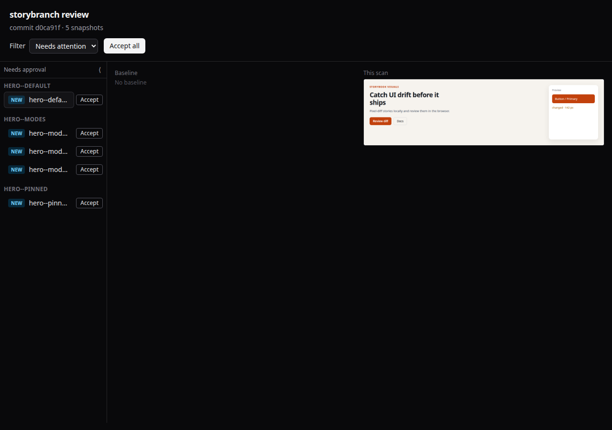
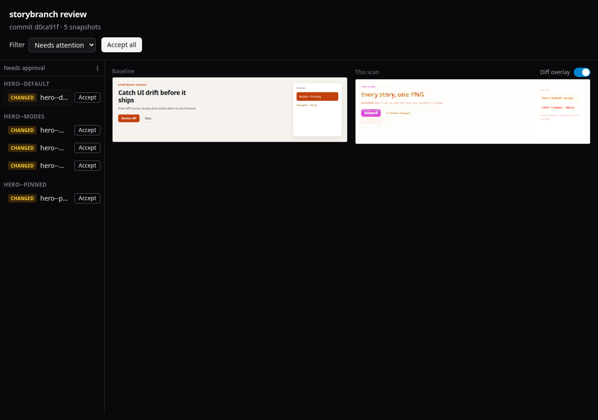

# storybranch

> **Alpha / WIP** — This project is in active development. APIs and behavior may change. **Use at your own risk.**

**Open-source, self-hosted visual testing for Storybook** — the capture → diff → review loop teams know from [Chromatic](https://www.chromatic.com/), designed to **run on your machine** and **deploy on infrastructure you control**.

storybranch drives Playwright against your Storybook, saves one PNG per story (and per [Chromatic mode](https://www.chromatic.com/docs/modes/)), compares them to baselines you keep in git, and opens a review UI when something needs your attention. Use it locally while you develop, or self-host the same CLI in CI — baselines and diffs live under `.storybranch/` on disk.

## Contents

- [Why storybranch](#why-storybranch)
- [Self-hosted and local](#self-hosted-and-local)
- [Install](#install)
- [Quick start](#quick-start)
- [From source](#from-source)
  - [For agents](#for-agents)
- [How it works](#how-it-works)
  - [First run — missing baselines](#first-run--missing-baselines)
  - [UI change — pixel diff](#ui-change--pixel-diff)
- [Features](#features)
- [Usage](#usage)
  - [Artifacts](#artifacts)
  - [Review UI](#review-ui)
- [Project structure](#project-structure)
- [Development](#development)
  - [Review UI (HMR)](#review-ui-hmr)
  - [Landing site](#landing-site)
- [Imports](#imports)

## Why storybranch

| | Chromatic (hosted SaaS) | storybranch |
| --- | --- | --- |
| **Where it runs** | Chromatic’s cloud | Your laptop, your CI runners, your servers |
| **Baselines** | Hosted project | Committed PNGs in `.storybranch/baseline/` |
| **Review** | chromatic.com | Review UI you serve (`storybranch review` on localhost by default) |
| **Storybook** | Chromatic build pipeline | Any URL you point at — especially `http://127.0.0.1:…` while developing |
| **License / cost** | Commercial product | Open source ([LICENSE](LICENSE)) |

storybranch is an **open-source, self-hosted** take on that workflow: you operate the tool, you own the artifacts, and you can keep the whole loop **local** during development.

It is not a drop-in Chromatic replacement for every feature (e.g. hosted Storybook builds, TurboSnap, or Chromatic’s GitHub App integrations). It **does** cover the core visual regression workflow for Storybook 10+ using Playwright capture, pixel diffs, and an accept/reject review experience.

## Self-hosted and local

Two goals drive the design:

1. **Self-hosted** — Run storybranch wherever you already run tooling (GitHub Actions, self-hosted runners, internal CI). Snapshots and reports stay in your repo and on your disks.
2. **Local** — Point `--url` at a Storybook dev server on your machine and get pixel diffs in seconds; open the review UI on `127.0.0.1` without waiting on a remote service.

Related behavior:

- **Baselines in git** — Reference images are normal files; PRs show baseline updates like any other asset change.
- **Offline-friendly local runs** — After install, capture and review against a local Storybook work without reaching a hosted visual-testing service.
- **Chromatic modes** — Multiple snapshots per story via [modes](https://www.chromatic.com/docs/modes/) naming, aligned with how Chromatic labels variant viewports/themes.

## Install

Install `@adriangohjw/storybranch` in the Storybook app you want to test. The CLI runtime still requires [Bun](https://bun.com) 1.4.3+.

**npm** (default):

```bash
npm install -D @adriangohjw/storybranch
npx playwright install chromium
```

**pnpm**:

```bash
pnpm add -D @adriangohjw/storybranch
pnpm exec playwright install chromium
```

**bun**:

```bash
bun add -d @adriangohjw/storybranch
bunx playwright install chromium
```

Publish from `apps/cli` when you are ready to put it on npm (`bun publish --access public`). Until it is on the registry, use [From source](#from-source).

## Quick start

Storybook 10 or newer has to be running. Chromatic `modes` or `viewports` on a story become extra snapshots. Setting both on one story is an error.

```bash
npx storybranch test --url http://127.0.0.1:6006
```

(`pnpm exec storybranch …` or `bunx storybranch …` if you use those package managers.)

`test` exits 1 when a snapshot needs attention. Failure lines are `missing baseline <file.png>`, `pixels <file.png>`, `size <file.png>`, or `stale <file.png>`. A clean run prints `ok`. The inventory is `.storybranch/report.json`. The CLI also prints `storybranch review at http://127.0.0.1:4321` when something needs a person.

The first run exits 1 with `missing baseline` for every shot. That is the baseline set, not a failed install. `approve` copies actuals into `.storybranch/baseline/`. Commit that directory and ignore the rest:

```gitignore
.storybranch/actual/
.storybranch/diff/
.storybranch/report.json
```

`review` and `--open` are for a person.

## From source

Clone this repo, build the review UI, then run the CLI **from your app** so `.storybranch/` is created there (for monorepo work or before the package is on npm):

```bash
git clone https://github.com/adriangohjw/storybranch.git
cd storybranch
bun install
bunx playwright install chromium
bun run build
cd /path/to/your-app
bun /path/to/storybranch/apps/cli/src/cli.ts test --url http://127.0.0.1:6006
```

To try the fixture in this repo instead of your app:

```bash
bunx storybook dev -p 6006 --config-dir packages/fixture/.storybook
bun apps/cli/src/cli.ts test --url http://127.0.0.1:6006
```

### For agents

Paste this into the Storybook app’s `AGENTS.md`. After `bun add -d @adriangohjw/storybranch`, use `bunx storybranch`. Until the package is on npm, `storybranch` means `bun /path/to/storybranch/apps/cli/src/cli.ts`.

```markdown
## storybranch

Storybook 10+ must already be running.

- `test --url <storybook>` — exit 1 means a visual diff. Lines: `missing baseline`, `pixels`, `size`, `stale`. A clean run prints `ok`.
- Read `.storybranch/report.json` (`new`, `changed`, `unchanged`, `stale`, `error`).
- The first run is `missing baseline` for every shot.
- Commit only `.storybranch/baseline/`. Ignore `actual/`, `diff/`, and `report.json`.
- Run `approve` only when asked to accept the shots. `review` and `--open` are for a person.
```

## How it works

1. **Capture** — `storybranch test --url <storybook>` walks `index.json`, screenshots each story, and writes actuals under `.storybranch/actual/<git-sha>/`.
2. **Compare** — Each PNG is diffed against `.storybranch/baseline/`. New stories, pixel changes, and stale baselines show up in `report.json`.
3. **Review** — When anything needs attention, a local server serves the review UI so you can compare baseline vs this scan (with an optional diff overlay) and accept updates.
4. **Commit** — Check updated baselines into git so the next run (and CI) share the same reference images.

### First run — missing baselines

Nothing in `.storybranch/baseline/` yet, so every snapshot is **new**. The CLI lists them and starts review on `http://127.0.0.1:4321` (by default):

```text
$ bunx storybranch test --url http://127.0.0.1:6006
storybranch review at http://127.0.0.1:4321
missing baseline hero--default__1200x900.png
missing baseline hero--modes__narrow.png
…
```



Use **Accept** (or `storybranch approve`) to copy actuals into `baseline/` and clear the failures.

### UI change — pixel diff

After you change a component, the next run marks mismatches as **changed** and highlights pixels with the diff overlay on **This scan**:

```text
$ bunx storybranch test --url http://127.0.0.1:6006
storybranch review at http://127.0.0.1:4321
pixels hero--default__1200x900.png
pixels hero--modes__narrow.png
…
```



The fixture story is a sample hero. The screenshot above is that hero after the primary CTA color shifts.

## Features

- ⚡ [Bun](https://bun.com) workspaces + [Turborepo](https://turbo.build) monorepo; Bun for runtime, tests, and CLI
- 🎨 [Oxlint](https://oxc.rs/docs/guide/usage/linter) + [Oxfmt](https://oxc.rs/docs/guide/usage/formatter) with [Ultracite](https://www.ultracite.dev/) presets; [Lefthook](https://lefthook.dev/) (`pre-commit` fix, `pre-push` CI checks)
- 💚 CI on GitHub Actions (single **✅ CI passed** required check):
  - ✅ Lint, format, typecheck, and `turbo` **build** (parallel jobs)
  - ✅ Tests with [Playwright](https://playwright.dev/) via `bun test`
  - ✅ Workflow linting with [jactionlint](https://github.com/rhysd/actionlint)
- 📖 [Storybook](https://storybook.js.org/) fixture for development and e2e coverage
- 🖼️ Local **review UI** (Vite + React) to compare baseline / actual / diff and accept snapshots in the browser
- 🌐 **Marketing site** (`apps/web`, Astro + Tailwind) — deploy details in [`apps/web/README.md`](apps/web/README.md)
- ⚙️ VS Code extension recommendations

## Usage

```bash
npx storybranch test --url http://127.0.0.1:6006
npx storybranch review
npx storybranch approve
```

Use `pnpm exec storybranch` or `bunx storybranch` when you installed with pnpm or bun. From a clone before npm publish, swap for `bun /path/to/storybranch/apps/cli/src/cli.ts` (see [From source](#from-source)).

### Artifacts

| Path | Role |
| --- | --- |
| `.storybranch/baseline/` | Committed reference PNGs |
| `.storybranch/actual/<commit>/` | Latest capture per git SHA (gitignored) |
| `.storybranch/diff/` | Pixel diff images (gitignored) |
| `.storybranch/report.json` | Last run inventory for the review UI (gitignored) |

### Review UI

See [How it works](#how-it-works) for screenshots. On a run with **missing / changed / stale** snapshots, `test` starts a background server on `http://127.0.0.1:4321` and prints the URL. Use the UI to filter shots, compare images, and **Accept** per snapshot or **Accept all** (baselines update immediately). `storybranch approve` still promotes every actual and removes stale baselines in one step.

| Command / flag | Effect |
| --- | --- |
| `test --open` | Open the review URL in your browser when review is offered |
| `test --review` | Offer review even when the run is fully green |
| `review [--open]` | Serve the last `report.json` until Ctrl+C |
| `review --once` | Exit when nothing needs attention |
| `--port` / `STORYBRANCH_PORT` | Override default port `4321` |

## Project structure

```
.github
  └─ workflows
        ├─ CI (lint, jactionlint, typecheck, format, build, test → ✅ CI passed)
        └─ codeql.yml
  └─ dependabot.yml
.vscode
  └─ Recommended extensions and editor settings
apps
  ├─ cli/         # Published `@adriangohjw/storybranch` package (bin, bundled CLI, review assets)
  ├─ review-ui/   # Vite + React review SPA (`@storybranch/review-ui`)
  └─ web/         # Marketing landing page (`@storybranch/web`, Astro)
packages
  ├─ core/        # Capture engine (`@storybranch/core`)
  ├─ fixture/     # Minimal Storybook app for tests and manual runs
  └─ report/      # Report types and JSON I/O (`@storybranch/report`)
tooling
  ├─ github/      # Shared composite action (Bun install + Turborepo cache)
  ├─ oxlint/      # `@storybranch/oxlint-config` (base + composable presets)
  ├─ oxfmt/       # `@storybranch/oxfmt-config`
  └─ typescript/  # `@storybranch/tsconfig` (`base.json`)
patches
  └─ Bun patches for dependencies
turbo.json
  └─ Turborepo task pipeline (`build`, `lint`, `format`, `typecheck`, `test`, `dev`)
lefthook.yml
  └─ `pre-commit`: `turbo` lint:fix / format:fix · `pre-push`: lint / format / typecheck
```

## Development

```bash
bun install           # runs `lefthook install` via prepare (skipped when CI=true)
bunx playwright install chromium
bunx storybook dev -p 6006 --config-dir packages/fixture/.storybook
bunx storybranch test --url http://127.0.0.1:6006
bun run lint          # turbo run lint (per-package oxlint)
bun run lint:fix
bun run format        # turbo run format (per-package oxfmt)
bun run format:fix
bun run typecheck     # turbo run typecheck (per-package `bun check`; requires Bun 1.4.3+)
bun run build         # review UI, CLI bundle, and marketing site
bun run test          # unit tests + Playwright e2e (install Chromium first)
```

### Publish

The npm package is `@adriangohjw/storybranch` (`apps/cli` only). The `storybranch` command comes from the package `bin`. `prepack` builds the review UI, bundles the CLI (so `@storybranch/core` and `@storybranch/report` are not separate installs), and drops workspace `devDependencies` from the tarball. `postpack` restores `apps/cli/package.json`. Runtime dependency ranges match the root catalog.

```bash
cd apps/cli
bun publish --access public
```

### Git hooks (Lefthook)

[`lefthook.yml`](lefthook.yml):

- **`pre-commit`** — `bun run lint:fix` and `bun run format:fix` (turbo, all packages)
- **`pre-push`** — same **lint**, **format**, and **typecheck** tasks as CI (`turbo run …`, in parallel)

Skip hooks with `git commit --no-verify` / `git push --no-verify`, or `LEFTHOOK=0` before the git command.

### Review UI (HMR)

1. Run a capture so `report.json` exists (or run `storybranch test --url …`).
2. Terminal A: `bunx storybranch review` (API on port 4321).
3. Terminal B: `bun run dev:review` (Vite dev server; proxies `/api` and `/images` to 4321).

Review UI assets are **not** committed (`apps/cli/review/public/assets/`, `index.html`). After `bun install`, run `bun run build` before `storybranch review` in this repo. CI has a dedicated **build** job (`bun run build`); tests depend on packages building via turbo. A published install already includes the built review UI and `dist/cli.js`.

### Landing site

From `apps/web` (or `bun run --filter @storybranch/web dev` at the repo root):

```bash
cd apps/web && bun run dev
```

Production hosting is **Cloudflare Pages** at [storybook.adriangohjw.com](https://storybook.adriangohjw.com) (Git integration, build watch paths on `apps/web/*`). See [`apps/web/README.md`](apps/web/README.md).

To refresh README screenshots after UI changes: `bun scripts/capture-readme-screenshots.ts` (requires Chromium from Playwright and a free port `6020` / `4322`).

The repo pins Bun via `packageManager` in `package.json`. CI reads that field through `oven-sh/setup-bun` and the shared `./tooling/github/setup` action.

Structure and tooling docs follow the same ideas as [Open Government Products Starter Kit](https://github.com/opengovsg/starter-kit) (apps vs packages vs tooling, shared CI setup and Turborepo cache).

## Imports

Third-party versions live in the root **`catalog`** in `package.json`; workspace packages reference them with `catalog:` (and each other with `workspace:*`). Cross-package imports use workspace names (e.g. `@storybranch/report`, `@storybranch/core/capture`). Within a package’s `src/`, import sibling modules with the `@/` alias (`paths` in that package’s `tsconfig.json`), not `./` or `../`; each package’s `oxlint.config.ts` composes `@storybranch/oxlint-config` blocks (e.g. `react-doctor` + `src-alias-imports` on CLI packages, `react-stack` on review UI). Shared lint/format/tsconfig live under `tooling/*` (`@storybranch/oxlint-config`, `@storybranch/oxfmt-config`, `@storybranch/tsconfig`).
